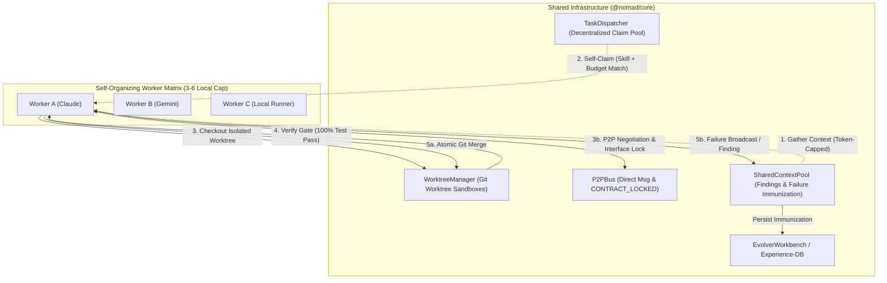

# RFC-0002: Agensh Decentralized Multi-Agent Swarm Architecture

**Author**: bobo li + Antigravity | **Date**: 2026-10-26 | **Status**: Accepted

---

## 1. Problem Statement

Traditional multi-agent systems rely on a centralized orchestrator (Master/Lead Agent) to decompose, assign, and merge tasks. As the number of concurrent agents grows, this creates an **Orchestrator Ceiling** (context window exhaustion, single point of failure, and sequential bottlenecking).

Inspired by Microsoft Research's **Agensh** (_Scaling Organizational Intelligence to 1,024 Agents_, arXiv:2609.26781), we upgrade the Nomad AI Workspace & Paperclip Task Control Plane from a centralized dispatch model into a **Decentralized Self-Organizing Swarm** tailored for local Mac Studio constraints (3–6 concurrent workers, strict token budget caps, and atomic `UnitResult<T, E>` contracts).

---

## 2. Capability Map & Proposed Solution

### 2.1 Phase 0 Capability Map

| Module ID          | Responsibility                                                                                                                                         | Depends On                                                    | Order |
| :----------------- | :----------------------------------------------------------------------------------------------------------------------------------------------------- | :------------------------------------------------------------ | :---- |
| `self-claim`       | Decentralized task claiming (`claimNextTask`) with skill/role affinity, token budget guard, and heartbeat lease locks                                  | `dispatcher`                                                  | 1     |
| `worktree-sandbox` | Physical Git Worktree lifecycle (`WorktreeManager`) with concurrency caps (`3..6`), Verify Gate (`100%` test pass before merge), and conflict rollback | `result`, `error-codes`                                       | 2     |
| `p2p-bus`          | Peer-to-peer direct negotiation (`agent:direct_message`) and `[CONTRACT_LOCKED]` interface lock registry (`P2PBus`)                                    | `result`, `error-codes`                                       | 3     |
| `shared-context`   | Shared findings & Failure Log immunization pool (`SharedContextPool`) bridged to `Headroom` token compression and `EvolverWorkbench` / Experience-DB   | `headroom`, `evolver`                                         | 4     |
| `agensh-routes`    | Unified HTTP & SSE gateway (`/api/agensh/*`, `/api/tasks/claim`) mounted identically on `@nomad/daemon` and `@nomad/desktop` + Dashboard UI            | `self-claim`, `worktree-sandbox`, `p2p-bus`, `shared-context` | 5     |

### 2.2 Architecture Topology

---

## 3. Alternatives Considered

1. **Full 1,024-Agent Cloud Cluster**: Rejected for local desktop workflow due to extreme API token cost and local Docker memory pressure. Capping local worktree concurrency at 3–6 agents with hybrid routing (Local LM Studio + Cloud APIs) achieves optimal throughput without exhausting 36GB+ unified memory.
2. **Centralized LLM Supervisor for Conflict Resolution**: Rejected because routing every file/signature overlap through a central LLM wastes tokens. Using structured `[CONTRACT_LOCKED]` declarations over `P2PBus` resolves interface locking deterministically in $O(1)$ time.

---

## 4. Rollback Plan

- All new capabilities are encapsulated in modular files under `packages/core/src/tasks/` (`worktree-manager.js`, `p2p-bus.js`, `shared-context-pool.js`, `agensh-routes.js`).
- `TaskDispatcher.claimTask(taskId, agentId, leaseDurationMs)` preserves 100% backward compatibility with existing callers; decentralized self-claiming is invoked via `claimNextTask(options)` or when `taskId` is omitted in `POST /api/tasks/claim`.
- Git worktrees reside in isolated temporary/configured directories (`~/.nomad/worktrees/<taskId>`) and can be pruned cleanly via `git worktree prune`.

---

## 5. Implementation & Verification Checklist

- [x] **Phase 1 (MVP)**: Implement decentralized self-claiming (`claimNextTask` & `/api/tasks/claim` auto-claim) with skill, role, and token budget filtering.
- [x] **Phase 2 (Make it Right)**: Implement `WorktreeManager` with concurrency guard, Verify Gate (`verifyWorktree`), atomic merge (`mergeWorktree`), and conflict abort + cleanup; implement `SharedContextPool` bridged with `Headroom` and `EvolverWorkbench`.
- [x] **Phase 3 (Make it Fast & Scalable)**: Implement `P2PBus` with `agent:direct_message` and `[CONTRACT_LOCKED]` interface lock enforcement; expose `/api/agensh/*` routes across Daemon and Desktop Bridge; integrate real-time Agensh Swarm panel into Dashboard UI.
- [x] **Verification**: 100% green unit & integration tests across `@nomad/core`, `@nomad/daemon`, and `@nomad/desktop`, `npm run types:check` 0 diff, and isolated subagent verification.
